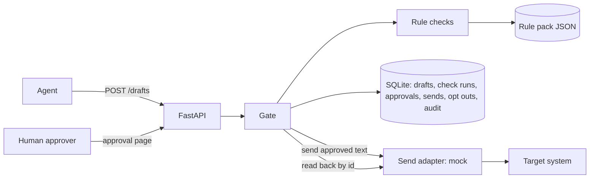
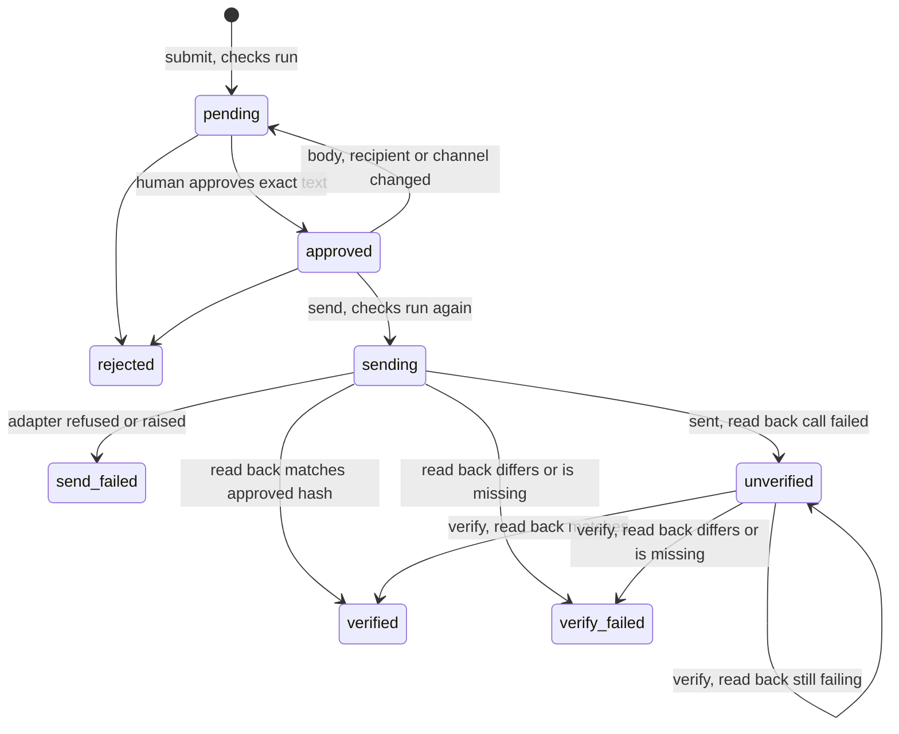

# send-gate

[](https://github.com/midcityhandyman/send-gate/actions/workflows/ci.yml)

**No AI-written message reaches a customer until a person has approved the exact text.**

If you let an AI agent text or email your customers, sooner or later it sends the wrong thing, to the wrong person, at the wrong hour. send-gate sits between the agent and the send button:

- The agent can only submit a draft. It cannot send on its own, and its credential cannot approve.
- Each draft is checked against your rules: quiet hours, people who opted out, repeats, and phrases you never want sent.
- A person reads the draft and approves it. If one character changes after that, the approval is cancelled and the draft goes back for review.
- After sending, the gate fetches the message back from the sending service and confirms it matches what was approved.
- Every step and every refusal is logged, so you can show later who approved what and what went out.

It is for a small business or team that wants agents to do the drafting while a person stays answerable for what customers receive.

This repository is a working reference build: a small web service (Python, FastAPI, SQLite) with a simulated sender, so it runs offline with no accounts or keys. Connecting a real SMS or email provider is the part left to do; see [Limitations](#limitations).

## What you will see

Excerpts copied from the output of the included demo (`python demo/run_demo.py`). The full run is in [demo/output.txt](demo/output.txt).

A clean draft is approved, sent, and read back from the target:

```
1. Clean draft: checks pass, human approves, gate sends and reads back
   submit: HTTP 201 status=pending verdict=ok
   approve: HTTP 200 status=approved verdict=ok
   send: HTTP 200 status=verified verdict=ok
      target id mock-000001 at 2026-11-10T15:00:00Z, read back ok=True
```

The agent edits a draft after it was approved. The approval is cancelled and the send is refused:

```
2. Edit after approval: the approval is void, the send is refused
   submit: HTTP 201 status=pending verdict=ok
   approve: HTTP 200 status=approved verdict=ok
   edit: HTTP 200 status=pending verdict=ok
      live approval after edit: None
   send: HTTP 409 not_approved: draft is pending, not approved
```

A draft with a banned phrase is stopped and cannot be approved until it is fixed:

```
3. Banned phrases: one stops the draft, one only cautions
   submit: HTTP 201 status=pending verdict=stop
      STOP    banned_phrases: Found "guaranteed" (stop: No guarantees in outbound messages.)
   approve: HTTP 409 blocked_by_rules: a rule check returned stop
      STOP    banned_phrases: Found "guaranteed" (stop: No guarantees in outbound messages.)
```

The agent holds its own token. That token cannot approve, in either header, and nothing answers without a token:

```
8. Tokens: the agent's credential cannot approve, and nothing works without one
   submit with no token: HTTP 401 agent_token_required: a valid X-Agent-Token header is required
   submit with the approver token: HTTP 401 agent_token_required: a valid X-Agent-Token header is required
   submit: HTTP 201 status=pending verdict=ok
   The agent tries to approve its own draft, under another name, with its own token:
   approve: HTTP 401 approver_token_required: a valid X-Approver-Token header is required
   It tries again with its token in the approver header:
   approve: HTTP 401 approver_token_required: a valid X-Approver-Token header is required
   list drafts with no token: HTTP 401 token_required
   The human approves with the approver token:
   approve: HTTP 200 status=approved verdict=ok
   send: HTTP 200 status=verified verdict=ok
```

The sending service accepts a message and then stops answering. The draft is parked as `unverified`, a second send is refused, and the check is retried without sending again:

```
   The target accepts a message, then its read back API goes down:
   submit: HTTP 201 status=pending verdict=ok
   approve: HTTP 200 status=approved verdict=ok
   send: HTTP 200 status=unverified verdict=ok
      send record error: read back failed (TimeoutError): read back timed out
   send: HTTP 409 not_approved: draft is unverified, not approved
   verify: HTTP 200 status=unverified verdict=ok
   The read back API returns:
   verify: HTTP 200 status=verified verdict=ok
      read back ok=True, adapter send calls for this draft: 1
```

The demo also covers an opt out, a duplicate, quiet hours holding a send until morning, a target that stored altered text, an adapter that throws an unexpected error, and an out of date rule set.

## Try it

Needs Python 3.11 or 3.12. Nothing else: no keys, no network after install.

```
python -m venv .venv
.venv\Scripts\activate
pip install -r requirements-dev.txt
python -m pytest
python demo/run_demo.py
```

On macOS or Linux the second line is `source .venv/bin/activate`. The tests report 253 passed. The demo prints its walk through and rewrites `demo/output.txt`.

The demo drives the real app in process with an in-memory database and a fixed clock, so its output is identical on every run and on every platform. CI reruns it and fails if the result differs from the committed `demo/output.txt` by a single byte. `requirements.lock` lists the exact versions it was last run with.

To run the service and the approval page (`requirements.txt` alone is enough for this), choose two different tokens of at least 16 characters, one for the agent and one for the human approver. The service refuses to start without them. In PowerShell:

```
$env:SEND_GATE_AGENT_TOKEN = "choose-a-long-agent-token"
$env:SEND_GATE_APPROVER_TOKEN = "choose-a-long-approver-token"
python -m send_gate init
uvicorn send_gate.api:app_factory --factory
```

On macOS or Linux use `export SEND_GATE_AGENT_TOKEN=choose-a-long-agent-token` and the same for the approver token. `python -c "import secrets; print(secrets.token_urlsafe(32))"` prints a good one. The `init` line is optional: it creates the database and prints the state of the rule pack, which the service would otherwise do silently on first start.

Open http://127.0.0.1:8000/ for the approval page and type the approver token into it, or open http://127.0.0.1:8000/docs for the API. Submit a draft as the agent and it appears on the page:

```
curl -X POST http://127.0.0.1:8000/drafts -H "Content-Type: application/json" \
  -H "X-Agent-Token: choose-a-long-agent-token" \
  -d '{"agent":"scheduler-bot","channel":"sms","recipient":"555-555-0142","body":"Hi Alex, your visit is booked for Tuesday at 9am."}'
```

The rest of the configuration is optional and lives in environment variables; see `.env.example`. With only the tokens set the gate uses `send_gate.db` in the current folder, the shipped sample rule pack and the mock adapter.

## How it works

1. An agent submits a draft (channel, recipient, body) over HTTP.
2. Five rule checks run and produce a verdict of `ok`, `caution` or `stop`:

   | Check | caution | stop |
   | --- | --- | --- |
   | `quiet_hours` | inside quiet hours at submit or approve time | inside quiet hours at send time |
   | `duplicate_send` | identical open draft, or another message to the same recipient minutes ago | same text already sent to the same recipient inside the window |
   | `opt_out` | | recipient is on the opt out list for that channel |
   | `banned_phrases` | a phrase marked caution in the rule pack | a phrase marked stop in the rule pack |
   | `stale_rule_pack` | the rule pack is past its review date | the rule pack is past its hard limit |

3. A human approves the exact text. The approval is bound to a SHA-256 hash of (channel, recipient, body). The approver sends back the hash of the text they were shown, so approving a draft that changed while they were reading is refused.
4. Any change to body, recipient or channel voids the approval and returns the draft to pending. One trailing space counts. Editing back to the old text does not revive the old approval.
5. A send adapter (mock in this repository) sends the message. The checks run again right before the send, so an opt out or quiet hours that arrived after approval still stop it.
6. The gate reads the message back from the target by id, compares it to the approved hash, and records the target id and timestamp. If the target holds different text, or nothing, the draft ends as `verify_failed` instead of `verified`.
7. Every step and every refusal is written to an append only, hash chained audit trail.

A `stop` blocks approval. A `caution` needs an explicit acknowledgement from the approver. The submitting agent cannot approve its own draft.

A draft is handed to the adapter at most once and never rests in `sending`:

- The adapter refuses the message, or throws anything else (a bug, a dropped connection, a receipt with no id): the draft closes as `send_failed`. The gate cannot know whether the message went out, so it never retries. A person decides whether to submit a new draft.
- The target accepted the message but the read back call itself failed: the draft is parked as `unverified`. `POST /drafts/{id}/verify` retries the read back, which is safe to repeat, and never calls send. It ends in `verified` or `verify_failed` like any other read back.
- The process was killed mid send: the draft is found in `sending` after a restart. The same `verify` call settles it. If the target id was recorded it retries the read back; if not, it closes the draft as `send_failed`.





## Tokens

Two header tokens, read from the environment at start. They are compared in constant time, must differ, and the service will not start without both.

| Token | Header | Held by | Can | Cannot |
| --- | --- | --- | --- | --- |
| `SEND_GATE_AGENT_TOKEN` | `X-Agent-Token` | the agent | submit and edit drafts, re-run checks, send an approved draft, retry a read back, read | approve, reject, change the opt out list |
| `SEND_GATE_APPROVER_TOKEN` | `X-Approver-Token` | the human, typed into the approval page | approve, reject, add opt outs, send an approved draft, re-run checks, retry a read back, read | submit or edit drafts |

Approve only checks the approver header against the approver token, so an agent token is refused there whichever header it arrives in. Send, recheck and verify accept either token because none of them can put new text in front of a customer: send only carries out an approval that already exists for that exact text. Every read needs one of the two tokens, since drafts hold customer numbers and message text. Only the approval page shell, `/healthz` and the API docs answer without a token. A test walks every route the app serves and fails if a new one is added without a token rule.

## Rule pack review

A rule pack carries the date a person last reviewed it. Past `max_age_days` every draft gets a caution; past `hard_max_age_days` every draft is stopped. Rules nobody has looked at in months should not keep approving messages.

That check would make this repository break on its own. A pack shipped with a fixed date would start cautioning about 90 days after it was written and stop everything after 180, for anyone who cloned it later. So the shipped pack, `rules/default_pack.json`, is declared as a sample and has no date in the file:

```
"sample": true,
"reviewed_at": "first_run",
```

- The first time a gate opens a database with a sample pack, it records that day in the database as the review date and writes a `sample_pack_dated` audit event. `python -m send_gate init` does this explicitly and prints the result. A fresh clone therefore works whenever you try it.
- From that day the sample ages exactly like a real pack: caution after 90 days, stop after 180. Restarting the service or editing the pack does not reset the date. `python -m send_gate init --restamp` records that a person re-read the sample today; it is audited and refuses to run against a real pack.
- A real pack gets none of this. `"reviewed_at": "first_run"` is rejected unless the pack says `"sample": true`, a pack with a date in the file always uses that date, and nothing in the database can make a dated pack look fresher. To make the pack yours, copy it, set `"sample": false` and put the day you reviewed it in `reviewed_at`.

`GET /rule-pack` shows `sample`, the review date in force and where it came from. The tests run a fresh install with the clock set to 2031 and show it working, then show a dated pack on the same clock being cautioned and stopped.

## Code layout

```
send_gate/
  fingerprint.py   recipient normalisation and the content hash
  rules.py         rule pack parsing and the five checks (pure functions)
  gate.py          draft lifecycle, approval binding, send, read back, audit
  adapters.py      adapter protocol and the mock target
  db.py            SQLite schema
  api.py           FastAPI routes and the two token checks
  __main__.py      python -m send_gate init
  static/index.html  approval page (plain HTML and JavaScript)
rules/default_pack.json   sample pack: quiet hours, banned phrases, windows
demo/                     offline demo, its rule pack and captured output
tests/                    253 tests
```

The tests use a temporary SQLite file, the mock adapter and a hand moved clock. CI (`.github/workflows/ci.yml`) runs the tests and the demo on Python 3.11 and 3.12 on every push, and checks the demo output against the committed copy. `.gitattributes` keeps every text file on LF line endings so that comparison holds on Windows too.

Endpoints:

| Method and path | Token | Purpose |
| --- | --- | --- |
| `POST /drafts` | agent | submit a draft; checks run |
| `PATCH /drafts/{id}` | agent | edit body, recipient or channel; voids any approval |
| `POST /drafts/{id}/approve` | approver | approve; body carries `approver`, `content_hash`, `acknowledge_cautions` |
| `POST /drafts/{id}/reject` | approver | reject |
| `POST /opt-outs` | approver | add a recipient to the opt out list |
| `POST /drafts/{id}/recheck` | either | run the checks again on an open draft |
| `POST /drafts/{id}/send` | either | send an approved draft and read it back |
| `POST /drafts/{id}/verify` | either | retry the read back for an `unverified` draft, or settle one left in `sending`; never sends |
| `GET /drafts?status=pending`, `GET /drafts/{id}` | either | list or read drafts |
| `GET /drafts/{id}/audit`, `GET /audit` | either | audit trail |
| `GET /audit/verify` | either | recompute the audit hash chain |
| `GET /opt-outs` | either | read the opt out list |
| `GET /rule-pack` | either | the rule pack in force, its review date and its hash |
| `GET /`, `GET /healthz`, `GET /docs` | none | approval page shell, health, API docs |

## Where this pattern comes from

This is a clean rewrite of a pattern drawn from systems that run two small service companies day to day, where agents draft customer and crew messages and a person approves each one before it leaves. The parts that earned their place there are the ones kept here: approval tied to the exact text, checks repeated at send time, and reading the message back from the target instead of trusting the send call. No code or data from those systems is in this repository; every name, number and message here is made up.

## Limitations

- Only a mock adapter ships, so this repository has never sent a real SMS or email. A real adapter has to implement `send` and `read_back` (see `SendAdapter` in `send_gate/adapters.py`), and read back is only as good as what the provider's API returns. Many providers report the stored body but not what the handset or inbox showed.
- The gate only protects messages that go through it. If the agent also holds the provider's credentials it can send around the gate; keep those credentials with the gate alone.
- Identity is still thin. The two tokens separate the agent role from the approver role, and that is all they do. Each is one shared secret: every approver uses the same token, so the approver name in the audit trail is whatever the caller typed, and there are no user accounts, sessions, expiry or rotation. Tokens travel in a plain header, so run this behind TLS. Refused token attempts are not written to the audit trail and are not rate limited.
- The approver token can also send, recheck and retry a read back, so that the approval page works with one token. It cannot submit or edit, but a person holding both tokens can do everything.
- The self approval check compares names only, so it stops accidents, not a caller that lies about its name. What actually keeps an agent from approving is that it does not hold the approver token.
- A failed send is final. The gate cannot tell a clean refusal from a timeout where the message may have gone out, so it closes the draft as `send_failed` and leaves the decision to resubmit to a person. The duplicate check only knows about sends the target confirmed with an id, so it will not catch a resubmission of a message that went out during a timeout.
- A draft left in `sending` by a killed process is not settled on its own. Someone has to call `verify` for it; there is no background recovery job. That call trusts that no other process is mid send on the same database, which holds for the single process this is built for.
- An `unverified` draft stays that way until someone calls `verify`. Nothing retries on a timer.
- One SQLite connection behind a lock, held during the adapter call. Fine for a small team and one process, not for high volume or several workers.
- The audit trail is tamper evident, not tamper proof. Triggers refuse updates and deletes and a hash chain exposes edits, but someone with file access can rewrite the whole chain. Ship the chain head somewhere else if that matters.
- Banned phrase matching is literal (case and whitespace insensitive, whole words). It does not catch misspellings or paraphrases.
- Quiet hours use one timezone from the rule pack, not the recipient's own timezone, and the shipped pack applies them to SMS only.
- Cautions that first appear at send time are recorded but do not block the send; only stops do.
- The shipped rule pack is a sample and dates itself on first run (see [Rule pack review](#rule-pack-review)). Ninety days after that the gate cautions on every draft and after 180 days it stops them, by design. Anyone can mark their own pack as a sample to get the same first run date; that moves the starting day, it does not switch the check off. Deleting the database resets the date, along with everything else in it.
- The approval page was exercised by hand in one desktop browser (token entry, approve with a caution, send). Its Retry read back button for an `unverified` draft has only been exercised through the API it calls. The page has no automated browser tests, and it keeps the approver token in the page for as long as the tab is open.

License: MIT, see the LICENSE file.
