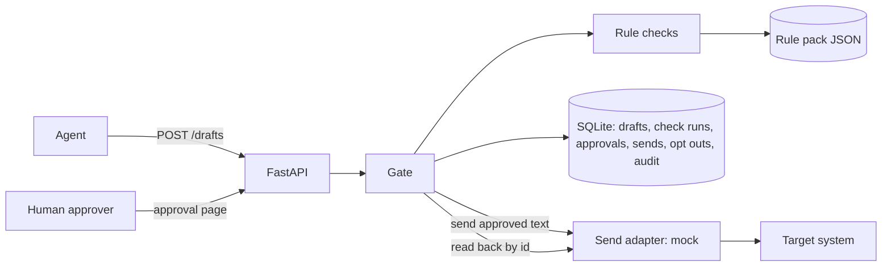
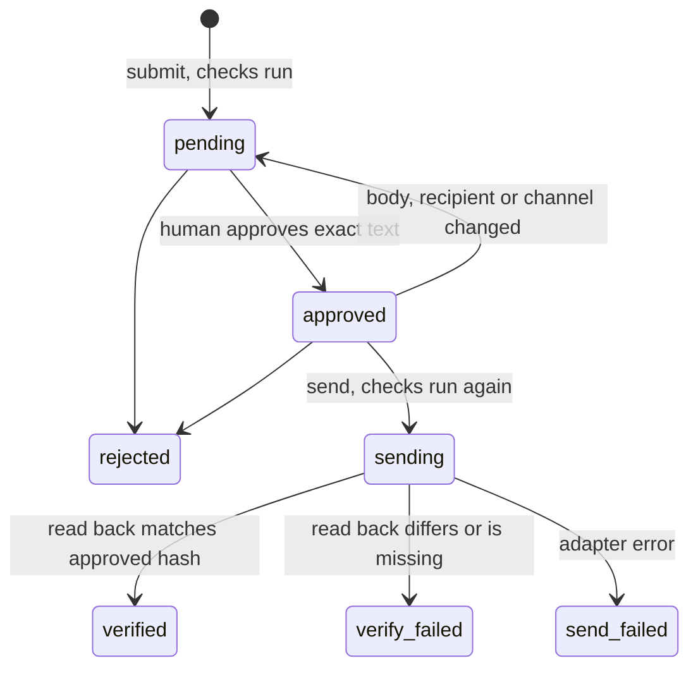

# send-gate

[](https://github.com/midcityhandyman/send-gate/actions/workflows/ci.yml)

**No AI-written message reaches a customer until a person has approved the exact text.**

If you let an AI agent text or email your customers, sooner or later it sends the wrong thing, to the wrong person, at the wrong hour. send-gate sits between the agent and the send button:

- The agent can only submit a draft. It cannot send on its own.
- Each draft is checked against your rules: quiet hours, people who opted out, repeats, and phrases you never want sent.
- A person reads the draft and approves it. If one character changes after that, the approval is cancelled and the draft goes back for review.
- After sending, the gate fetches the message back from the sending service and confirms it matches what was approved.
- Every step and every refusal is logged, so you can show later who approved what and what went out.

It is for a small business or team that wants agents to do the drafting while a person stays answerable for what customers receive.

This repository is a working reference build: a small web service (Python, FastAPI, SQLite) with a simulated sender, so it runs offline with no accounts or keys. Connecting a real SMS or email provider is the part left to do; see [Limitations](#limitations).

## What you will see

Excerpts copied from the output of the included demo (`python demo/run_demo.py`). The full run is in [demo/output.txt](demo/output.txt).

A clean draft is approved, sent, and read back from the target:

```
1. Clean draft: checks pass, human approves, gate sends and reads back
   submit: HTTP 201 status=pending verdict=ok
   approve: HTTP 200 status=approved verdict=ok
   send: HTTP 200 status=verified verdict=ok
      target id mock-000001 at 2026-11-10T15:00:00Z, read back ok=True
```

The agent edits a draft after it was approved. The approval is cancelled and the send is refused:

```
2. Edit after approval: the approval is void, the send is refused
   submit: HTTP 201 status=pending verdict=ok
   approve: HTTP 200 status=approved verdict=ok
   edit: HTTP 200 status=pending verdict=ok
      live approval after edit: None
   send: HTTP 409 not_approved: draft is pending, not approved
```

A draft with a banned phrase is stopped and cannot be approved until it is fixed:

```
3. Banned phrases: one stops the draft, one only cautions
   submit: HTTP 201 status=pending verdict=stop
      STOP    banned_phrases: Found "guaranteed" (stop: No guarantees in outbound messages.)
   approve: HTTP 409 blocked_by_rules: a rule check returned stop
      STOP    banned_phrases: Found "guaranteed" (stop: No guarantees in outbound messages.)
```

The demo also covers an opt out, a duplicate, quiet hours holding a send until morning, a target that stored altered text, and an out of date rule set.

## Try it

Needs Python 3.11 or 3.12. Nothing else: no keys, no network after install.

```
python -m venv .venv
.venv\Scripts\activate
pip install -r requirements-dev.txt
python -m pytest
python demo/run_demo.py
```

On macOS or Linux the second line is `source .venv/bin/activate`. The tests report 78 passed. The demo prints its walk through and rewrites `demo/output.txt`.

The demo drives the real app in process with an in-memory database and a fixed clock, so its output is identical on every run. `requirements.lock` lists the exact versions it was last run with.

To run the service and the approval page (`requirements.txt` alone is enough for this):

```
uvicorn send_gate.api:app_factory --factory
```

Open http://127.0.0.1:8000/ for the approval page, or http://127.0.0.1:8000/docs for the API. Submit a draft and it appears on the page:

```
curl -X POST http://127.0.0.1:8000/drafts -H "Content-Type: application/json" \
  -d '{"agent":"scheduler-bot","channel":"sms","recipient":"555-555-0142","body":"Hi Alex, your visit is booked for Tuesday at 9am."}'
```

Configuration is optional and lives in environment variables; see `.env.example`. With nothing set the gate uses `send_gate.db` in the current folder, the shipped rule pack and the mock adapter.

## How it works

1. An agent submits a draft (channel, recipient, body) over HTTP.
2. Five rule checks run and produce a verdict of `ok`, `caution` or `stop`:

   | Check | caution | stop |
   | --- | --- | --- |
   | `quiet_hours` | inside quiet hours at submit or approve time | inside quiet hours at send time |
   | `duplicate_send` | identical open draft, or another message to the same recipient minutes ago | same text already sent to the same recipient inside the window |
   | `opt_out` | | recipient is on the opt out list for that channel |
   | `banned_phrases` | a phrase marked caution in the rule pack | a phrase marked stop in the rule pack |
   | `stale_rule_pack` | the rule pack is past its review date | the rule pack is past its hard limit |

3. A human approves the exact text. The approval is bound to a SHA-256 hash of (channel, recipient, body). The approver sends back the hash of the text they were shown, so approving a draft that changed while they were reading is refused.
4. Any change to body, recipient or channel voids the approval and returns the draft to pending. One trailing space counts. Editing back to the old text does not revive the old approval.
5. A send adapter (mock in this repository) sends the message. The checks run again right before the send, so an opt out or quiet hours that arrived after approval still stop it.
6. The gate reads the message back from the target by id, compares it to the approved hash, and records the target id and timestamp. If the target holds different text, or nothing, the draft ends as `verify_failed` instead of `verified`.
7. Every step and every refusal is written to an append only, hash chained audit trail.

A `stop` blocks approval. A `caution` needs an explicit acknowledgement from the approver. The submitting agent cannot approve its own draft.





## Code layout

```
send_gate/
  fingerprint.py   recipient normalisation and the content hash
  rules.py         rule pack parsing and the five checks (pure functions)
  gate.py          draft lifecycle, approval binding, send, read back, audit
  adapters.py      adapter protocol and the mock target
  db.py            SQLite schema
  api.py           FastAPI routes
  static/index.html  approval page (plain HTML and JavaScript)
rules/default_pack.json   quiet hours, banned phrases, windows, review date
demo/                     offline demo, its rule pack and captured output
tests/                    78 tests
```

The tests use a temporary SQLite file, the mock adapter and a hand moved clock. CI (`.github/workflows/ci.yml`) runs the tests and the demo on Python 3.11 and 3.12 on every push.

Main endpoints:

| Method and path | Purpose |
| --- | --- |
| `POST /drafts` | agent submits a draft; checks run |
| `GET /drafts?status=pending` | list drafts |
| `PATCH /drafts/{id}` | edit body, recipient or channel; voids any approval |
| `POST /drafts/{id}/recheck` | run the checks again on an open draft |
| `POST /drafts/{id}/approve` | human approves; body carries `approver`, `content_hash`, `acknowledge_cautions` |
| `POST /drafts/{id}/reject` | human rejects |
| `POST /drafts/{id}/send` | send an approved draft and read it back |
| `GET /drafts/{id}/audit`, `GET /audit` | audit trail |
| `GET /audit/verify` | recompute the audit hash chain |
| `GET /opt-outs`, `POST /opt-outs` | opt out list |
| `GET /rule-pack` | the rule pack in force and its hash |

## Where this pattern comes from

This is a clean rewrite of a pattern drawn from systems that run two small service companies day to day, where agents draft customer and crew messages and a person approves each one before it leaves. The parts that earned their place there are the ones kept here: approval tied to the exact text, checks repeated at send time, and reading the message back from the target instead of trusting the send call. No code or data from those systems is in this repository; every name, number and message here is made up.

## Limitations

- Only a mock adapter ships, so this repository has never sent a real SMS or email. A real adapter has to implement `send` and `read_back` (see `SendAdapter` in `send_gate/adapters.py`), and read back is only as good as what the provider's API returns. Many providers report the stored body but not what the handset or inbox showed.
- The gate only protects messages that go through it. If the agent also holds the provider's credentials it can send around the gate; keep those credentials with the gate alone.
- Identity is weak. Approver and agent names are plain strings supplied by the caller. One optional shared token (`SEND_GATE_APPROVER_TOKEN`) guards approve and reject; submit, edit, send and the opt out list are open to any caller, and there are no user accounts, sessions or roles. Put this behind real authentication before exposing it.
- The self approval check compares names only, so it stops accidents, not a caller that lies about its name.
- A failed send is final. The gate cannot tell a clean refusal from a timeout where the message may have gone out, so it closes the draft as `send_failed` and leaves the decision to resubmit to a person.
- If the process dies between the adapter call and the read back, the draft stays in `sending`. There is no recovery job; someone has to look at the target and the audit trail.
- One SQLite connection behind a lock, held during the adapter call. Fine for a small team and one process, not for high volume or several workers.
- The audit trail is tamper evident, not tamper proof. Triggers refuse updates and deletes and a hash chain exposes edits, but someone with file access can rewrite the whole chain. Ship the chain head somewhere else if that matters.
- Banned phrase matching is literal (case and whitespace insensitive, whole words). It does not catch misspellings or paraphrases.
- Quiet hours use one timezone from the rule pack, not the recipient's own timezone, and the shipped pack applies them to SMS only.
- Cautions that first appear at send time are recorded but do not block the send; only stops do.
- The shipped rule pack was last reviewed on 2026-11-01. Ninety days after that the gate cautions on every draft and after 180 days it stops them, by design. Review the pack and update `reviewed_at`.
- The approval page was exercised by hand in one desktop browser. It has no automated browser tests.

License: MIT, see the LICENSE file.
