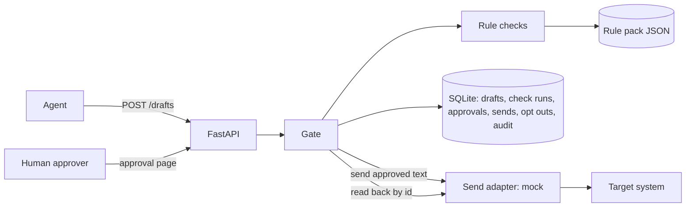
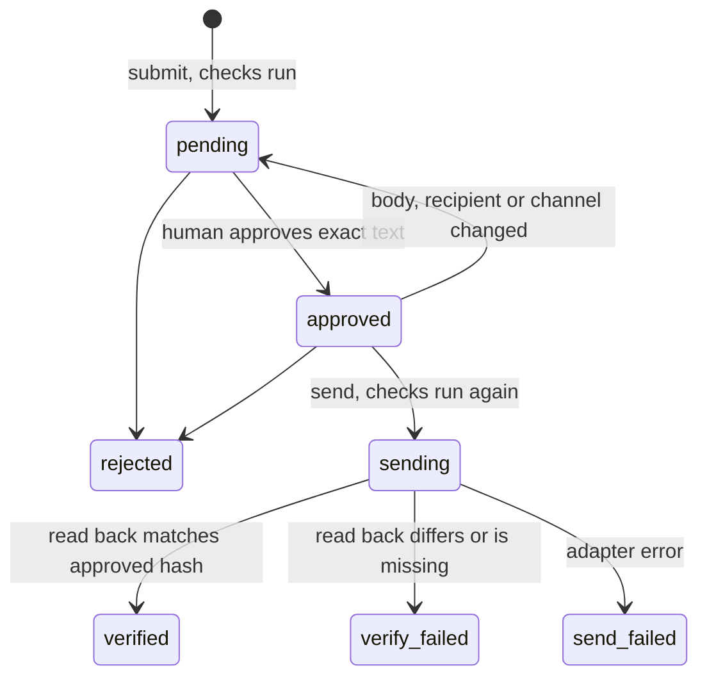

# send-gate

An agent that can text or email customers will sooner or later send the wrong thing to the wrong person at the wrong hour.
send-gate puts a rule check and a human approval between the agent's draft and the send, then proves what actually went out.

## What it does

1. An agent submits a draft (channel, recipient, body) over HTTP.
2. Five rule checks run and produce a verdict of `ok`, `caution` or `stop`:

   | Check | caution | stop |
   | --- | --- | --- |
   | `quiet_hours` | inside quiet hours at submit or approve time | inside quiet hours at send time |
   | `duplicate_send` | identical open draft, or another message to the same recipient minutes ago | same text already sent to the same recipient inside the window |
   | `opt_out` | | recipient is on the opt out list for that channel |
   | `banned_phrases` | a phrase marked caution in the rule pack | a phrase marked stop in the rule pack |
   | `stale_rule_pack` | the rule pack is past its review date | the rule pack is past its hard limit |

3. A human approves the exact text. The approval is bound to a SHA-256 hash of (channel, recipient, body). The approver sends back the hash of the text they were shown, so approving a draft that changed while they were reading is refused.
4. Any change to body, recipient or channel voids the approval and returns the draft to pending. One trailing space counts. Editing back to the old text does not revive the old approval.
5. A send adapter (mock in this repository) sends the message. The checks run again right before the send, so an opt out or quiet hours that arrived after approval still stop it.
6. The gate reads the message back from the target by id, compares it to the approved hash, and records the target id and timestamp. If the target holds different text, or nothing, the draft ends as `verify_failed` instead of `verified`.
7. Every step and every refusal is written to an append only, hash chained audit trail.

A `stop` blocks approval. A `caution` needs an explicit acknowledgement from the approver. The submitting agent cannot approve its own draft.

## Architecture





Layout:

```
send_gate/
  fingerprint.py   recipient normalisation and the content hash
  rules.py         rule pack parsing and the five checks (pure functions)
  gate.py          draft lifecycle, approval binding, send, read back, audit
  adapters.py      adapter protocol and the mock target
  db.py            SQLite schema
  api.py           FastAPI routes
  static/index.html  approval page (plain HTML and JavaScript)
rules/default_pack.json   quiet hours, banned phrases, windows, review date
demo/                     offline demo, its rule pack and captured output
tests/                    78 tests
```

## Run it

```
pip install -r requirements.txt
uvicorn send_gate.api:app_factory --factory
```

Then open http://127.0.0.1:8000/ for the approval page, or http://127.0.0.1:8000/docs for the API. Submit a draft to see it appear:

```
curl -X POST http://127.0.0.1:8000/drafts -H "Content-Type: application/json" \
  -d '{"agent":"scheduler-bot","channel":"sms","recipient":"555-555-0142","body":"Hi Alex, your visit is booked for Tuesday at 9am."}'
```

Configuration is optional and lives in environment variables; see `.env.example`. With nothing set the gate uses `send_gate.db` in the current folder, the shipped rule pack and the mock adapter, and needs no keys or network.

Main endpoints:

| Method and path | Purpose |
| --- | --- |
| `POST /drafts` | agent submits a draft; checks run |
| `GET /drafts?status=pending` | list drafts |
| `PATCH /drafts/{id}` | edit body, recipient or channel; voids any approval |
| `POST /drafts/{id}/approve` | human approves; body carries `approver`, `content_hash`, `acknowledge_cautions` |
| `POST /drafts/{id}/reject` | human rejects |
| `POST /drafts/{id}/send` | send an approved draft and read it back |
| `GET /drafts/{id}/audit`, `GET /audit` | audit trail |
| `GET /audit/verify` | recompute the audit hash chain |
| `GET /opt-outs`, `POST /opt-outs` | opt out list |
| `GET /rule-pack` | the rule pack in force and its hash |

## Tests

```
pip install -r requirements-dev.txt
python -m pytest
```

The tests use a temporary SQLite file, the mock adapter and a hand moved clock. CI (`.github/workflows/ci.yml`) runs the tests and the demo on Python 3.11 and 3.12.

## Demo

```
python demo/run_demo.py
```

The demo drives the real FastAPI app in process with an in-memory database and a fixed clock, so its output is identical on every run. It walks through: a clean send with read back, an edit that voids an approval, banned phrases, an opt out, a duplicate, quiet hours holding a send until morning, a target that stored altered text, and a stale rule pack. The captured output is in [demo/output.txt](demo/output.txt). A short excerpt:

```
2. Edit after approval: the approval is void, the send is refused
   submit: HTTP 201 status=pending verdict=ok
   approve: HTTP 200 status=approved verdict=ok
   edit: HTTP 200 status=pending verdict=ok
      live approval after edit: None
   send: HTTP 409 not_approved: draft is pending, not approved
```

## Where this pattern runs

This is a clean rewrite of a pattern drawn from systems that run two small service companies day to day, where agents draft customer and crew messages and a person approves each one before it leaves. The parts that earned their place there are the ones kept here: approval tied to the exact text, checks repeated at send time, and reading the message back from the target instead of trusting the send call.

## Limitations

- Only a mock adapter ships. A real SMS or email adapter has to implement `send` and `read_back` (see `SendAdapter` in `send_gate/adapters.py`), and read back is only as good as what the provider's API returns. Many providers report the stored body but not what the handset or inbox showed.
- Identity is weak. Approver and agent names are plain strings supplied by the caller. One optional shared token (`SEND_GATE_APPROVER_TOKEN`) guards approve and reject; there are no user accounts, sessions or roles. Put this behind real authentication before exposing it.
- The self approval check compares names only, so it stops accidents, not a caller that lies about its name.
- A failed send is final. The gate cannot tell a clean refusal from a timeout where the message may have gone out, so it closes the draft as `send_failed` and leaves the decision to resubmit to a person.
- If the process dies between the adapter call and the read back, the draft stays in `sending`. There is no recovery job; someone has to look at the target and the audit trail.
- One SQLite connection behind a lock, held during the adapter call. Fine for a small team and one process, not for high volume or several workers.
- The audit trail is tamper evident, not tamper proof. Triggers refuse updates and deletes and a hash chain exposes edits, but someone with file access can rewrite the whole chain. Ship the chain head somewhere else if that matters.
- Banned phrase matching is literal (case and whitespace insensitive, whole words). It does not catch misspellings or paraphrases.
- Quiet hours use one timezone from the rule pack, not the recipient's own timezone.
- Cautions that first appear at send time are recorded but do not block the send; only stops do.
- The shipped rule pack has a review date. Ninety days after it the gate cautions on every draft and after 180 days it stops them, by design. Review the pack and update `reviewed_at`.
- The approval page was exercised by hand in one desktop browser. It has no automated browser tests.

License: MIT, see the LICENSE file.
